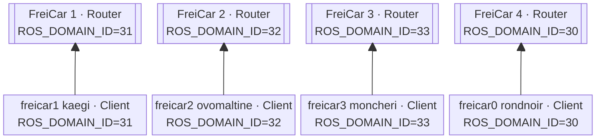
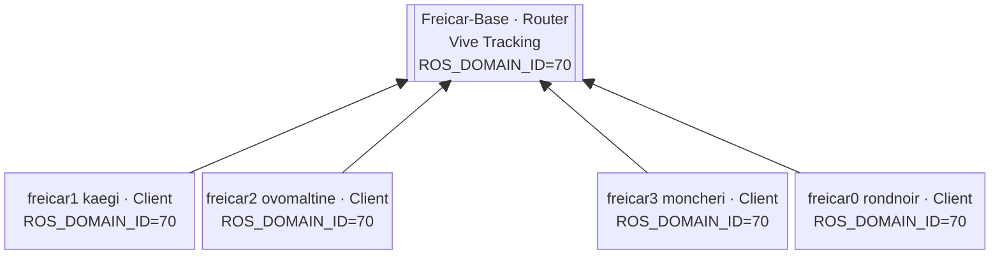
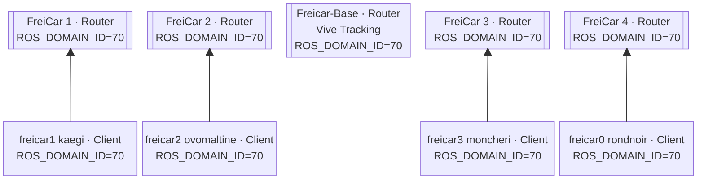

# Real-World Cars - Software

## Network Setup

In order to run one of the real FreiCARs, setting up the correct environment is crucial.
This involves setting the correct ROS_DOMAIN_ID to create a capsulated environment for your team, as well as starting a ROS2 Middleware service called Zenoh.
**IMPORTANT** Keep in mind that while you are using the tracking all teams and cars share the same ROS_DOMAIN_ID. That means that in order to keep everything working, make sure that all your publishers, subscribers, topics, services and frames you might want to provide are prefixed with your car name. Overview:

* The **freicar-base**: This is the machine that runs the Vive tracking and publishes the transforms in regards to the real-world cars.
* Any **student computer**: For connecting to the car via ssh and running `rviz2`. Other nodes may run here as well, but beware of network congestion if transmitting camera data.
* Any **FreiCAR**: The agent and any other real-time critical control code or code that processes images and sensor data should be run directly on the car. Otherwise, network lag may cause nondeterministic bugs and other issues.

Once Vive tracking is running, please proceed with the following steps to set up each of the machines:

### Modes
The `freicar_docker` is set up to run in two different modes:

* Client (student.env): This is the mode that should be used on student computers. It allows you to connect to Zenoh router running on *freicar-base* (or the robots) and visualize the published topics in `rviz2`. You can also run your own nodes here, but beware of network congestion if transmitting camera data.
* Router (robot.env): This is the mode that should be used on the FreiCARs. It starts a Zenoh router that allows other machines to connect to it and receive the published topics.

There are a few different constellations:
Each robot and its assigned student use the same ROS_DOMAIN_ID.
Different pairs can use separate domains.

<div class="zenoh-diagram zenoh-robots" markdown="1">



</div>

All participants use ROS_DOMAIN_ID=70.

<div class="zenoh-diagram zenoh-tracking" markdown="1">



</div>

All participants use ROS_DOMAIN_ID=70.

<div class="zenoh-diagram zenoh-combined" markdown="1">



</div>

**Legend:** Green arrows connect clients to routers. Thick dotted blue lines connect neighboring peer routers.

### *freicar-base* (Router and/or Client)

1. start Vive tracking as described in [vive_tracking.md](../vive_tracking)

    If using the FreiCar's, make sure that all robots are listed as peers in the `zenoh.env` config file in `/freicar/freicar/freicar_vive/config/zenoh.env`. If not, add them and restart the tracking script. *IMPORTANT*: Do not list the PC's own IP address as a peer, as this will cause the Zenoh router to crash.

2. set student.env as the active environment in the `freicar_docker` using:

        cp ~/freicar/freicar_docker/config/zenoh/student.env ~/freicar/freicar_docker/config/zenoh/active.env

3. Edit `active.env` and set the correct IP address of the *freicar-base* machine (in this case: `FREICAR_ZENOH_ENDPOINT='tcp/127.0.0.1:7447'`)

4. Start/attach to docker: ```rcc``` / ```rct```

### *Student Computers* (Client)

1. set student.env as the active environment in the `freicar_docker` using:

        cp ~/freicar/freicar_docker/config/zenoh/student.env ~/freicar/freicar_docker/config/zenoh/active.env

2. Edit `active.env` and set the correct IP address of one active Zenoh router:

    * With tracking active: `FREICAR_ZENOH_ENDPOINT='tcp/192.168.140.70:7447'` (IP of freicar-base)
    * Without tracking active: `FREICAR_ZENOH_ENDPOINT='tcp/192.168.140.3X:7447'` (IP of your car, replace X with your car number, or check the IP with ifconfig on the car)

3. Start/attach to docker: ```rcc``` / ```rct```

### *FreiCARs* (Router)
Finally, [start](../starting_charging_etc/) one of the cars and:

1. SSH from a student computer to the car via ```ssh freicar@freicarX (name of car)```.

    If no SSH connection is possible, please check that the car is connected to the wifi network freicar_5g (to do so connect a monitor, keyboard, and mouse)

2. set robot.env as the active environment in the `freicar_docker` using:

        cp ~/freicar/freicar_docker/config/zenoh/robot.env ~/freicar/freicar_docker/config/zenoh/active.env

3. Edit `active.env` and set the correct IP address of all the router peers:

    * With tracking active: `FREICAR_ZENOH_PEERS='["tcp/192.168.140.70:7447","tcp/192.168.140.32:7447","tcp/192.168.140.33:7447","tcp/192.168.140.34:7447"]'` (IP of freicar-base and all other cars except FreiCar 1) *IMPORTANT*: Do not list the PC's own IP address as a peer, as this will cause the Zenoh router to crash.
    * Without tracking active: `FREICAR_ZENOH_PEERS='["tcp/192.168.140.3X:7447","tcp/192.168.140.3Y:7447","tcp/192.168.140.3Z:7447"]` (IP of all other cars except the current one, replace X/Y/Z with the car numbers) *IMPORTANT*: Do not list the PC's own IP address as a peer, as this will cause the Zenoh router to crash.

4. Start the docker container on the car: ```rcc``` (this will also start the Zenoh router)

    *Keep this terminal open at all times, as closing it will stop the Zenoh router and the docker container!*

5. Attach another terminal to the docker container: ```rct```

## Test setup

1. Start the Car in any of the two constellations described above.

2. Start the docker on the car

3. In another terminal on the car (in the attached docker) run

        source install/setup.bash
        ros2 launch freicar_agent ros2_hw.launch.py agent_name:=freicar_X

4. On the student computer, start the docker and run

        source install/setup.bash
        rviz2

5. In yet another terminal on the car (in the attached docker) run

        source install/setup.bash
        ros2 launch freicar_agent ros2_minimal_agent.py agent_name:=freicar_X

    **WARNING:** always place the car on a wood block and turn on the RC remote before launching untested agents. Please observe the [safety rules](../safety_rules).
